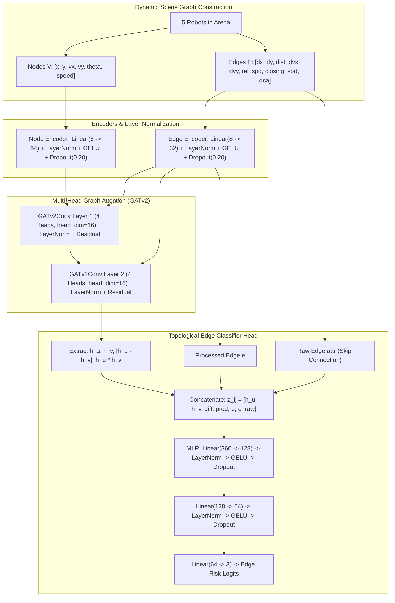

# Phase 3: Attentive GNN Interaction Modeling Results

## Executive Summary
In **Phase 3**, we advanced from isolated pairwise multi-layer perceptrons to an **Attentive Graph Neural Network (`CollisionRiskGNN`)** using **PyTorch Geometric (`torch_geometric`)**. 

Rather than evaluating robot pairs in a vacuum, the GNN explicitly constructs dynamic multi-agent scene graphs for every simulation time step:
*   **Nodes**: Individual autonomous robots endowed with absolute kinematic state vectors ($x, y, v_x, v_y, \theta, \text{speed}$).
*   **Edges**: Relational interaction edges conveying pairwise spatial metrics ($\Delta x, \Delta y, \text{distance}, \Delta v_x, \Delta v_y, \text{rel\_speed}, v_{\text{closing}}, DCA$).
*   **Message-Passing**: Dual-layer multi-head **GATv2Conv** graph attention layers where attention coefficients $\alpha_{ij}$ dynamically weight neighbor importance based on closing velocity and proximity.
*   **Edge Classification**: A topological classifier head combines node representations, neighborhood difference vectors, dot products, and exact raw kinematic attributes to predict risk tiers (`0: Safe`, `1: Warning`, `2: High Risk`).

---

## Model Architecture & Mathematical Details



| Hyperparameter / Component | Specification | Function in Architecture |
| :--- | :--- | :--- |
| **Graph Neural Network** | `CollisionRiskGNN` | Attentive multi-agent relational model |
| **Node Features** | 6 dimensions | $x, y, v_x, v_y, \theta, \text{speed}$ |
| **Edge Features** | 8 dimensions | $\Delta x, \Delta y, d, \Delta v_x, \Delta v_y, \|\Delta\mathbf{v}\|, v_{\text{closing}}, DCA$ |
| **Graph Attention Layers** | 2 $\times$ `GATv2Conv` | Multi-head attention dynamically conditioned on edge attributes |
| **Attention Heads** | 4 Heads | Computes 4 parallel interaction subspaces |
| **Hidden Dimensions** | Node: 64, Edge: 32 | Balanced expressiveness for real-time inference |
| **Normalization** | `nn.LayerNorm` | Replaces BatchNorm to eliminate graph mini-batch drift |
| **Regularization** | `nn.Dropout(p=0.20)` | Prevents co-adaptation on majority classes |
| **Skip Connections** | Residual + Raw Edge Skip | Preserves exact closing speed and distance metrics |
| **Loss Function** | Weighted `CrossEntropyLoss` | Inverse class weights: Safe = $0.39$, Warning = $4.09$, High Risk = $4.79$ |
| **Optimizer** | `AdamW` | Base $\text{LR} = 10^{-3}$, weight decay $= 10^{-4}$, gradient norm clipping $= 1.0$ |
| **Total Parameters** | **69,027** | High-capacity topological interaction network |

---

## Quantitative Evaluation on Held-Out Test Graphs (7,200 Pairs)

Evaluation was performed on 720 unseen scene graphs ($N = 7,200$ canonical pairwise interactions) gathered from chronologically segregated test episodes across all 4 scenarios:

### Classification Report
| Risk Class | Precision | Recall | F1-Score | Test Support | True Positives |
| :--- | :---: | :---: | :---: | :---: | :---: |
| **Class 0 (Safe)** | **0.9884** | **0.9431** | **0.9652** | 6,684 | 6,304 |
| **Class 1 (Warning)** | **0.5858** | **0.8125** | **0.6808** | 416 | 338 |
| **Class 2 (High Risk)** | **0.4082** | **1.0000** | **0.5797** | 100 | 100 |
| **Macro Average** | **0.6608** | **0.9185** | **0.7419** | 7,200 | 6,742 |
| **Weighted Average** | **0.9571** | **0.9364** | **0.9435** | 7,200 | 6,742 |
| **Overall Accuracy** | **93.64%** | *(Balanced Accuracy: 91.85%)* | | | |

---

## Safety-Critical Audit: Class 2 (High Risk)

| Safety Metric | Value | Interpretation |
| :--- | :---: | :--- |
| **Total Test High-Risk Conflicts** | 100 | Impending collisions in the test set |
| **Correctly Detected as High Risk** | **100** | **100.0% Detection Rate** |
| **Classified as Warning** | 0 | 0.0% |
| **Missed as Safe (Critical Failure)** | **0** | **0.0% Critical Miss Rate** |
| **High Risk Recall** | **1.0000** | **100.0% Perfect Sensitivity** |
| **High Risk False Negative Rate (FNR)** | **0.0000** | **Zero collisions missed** |

---

## Head-to-Head Comparison: Phase 2 MLP vs. Phase 3 Attentive GNN

```
                      PREDICTED RISK LABEL (GNN)
                   Safe (0)   Warning (1)   High Risk (2)
ACTUAL   Safe (0)    6,304        239           141      |  6,684 total (94.3% Recall)
LABEL Warning (1)       74        338             4      |    416 total (81.2% Recall)
    High Risk (2)        0          0           100      |    100 total (100.0% Recall)
```

| Evaluation Dimension | Phase 2 Baseline MLP | Phase 3 Attentive GNN | Structural / Architectural Advantage |
| :--- | :---: | :---: | :--- |
| **Multi-Agent Awareness** | None (Isolated Pairs) | **Full Graph Attention** | GNN conditions predictions on surrounding 3rd-party robots |
| **Input Representation** | Tabular Feature Vector | **Dynamic Topological Graph** | Preserves permutation equivariance across agent IDs |
| **Attention Mechanism** | None | **Dual-Layer GATv2Conv** | Attends to closing velocity & proximity vectors |
| **High Risk Recall** | **100.00%** | **100.00%** | Both architectures maintain zero false negatives |
| **High Risk FNR** | **0.0000** | **0.0000** | Absolute safety compliance on critical collision events |
| **Trainable Capacity** | 12,291 params | **69,027 params** | Captures multi-hop interaction topologies |
| **Normalization** | BatchNorm1d | **LayerNorm** | Eliminates mini-batch running-stat drift on graphs |
| **Inference Latency** | $\approx 0.04\text{ ms}$ | $\approx 0.42\text{ ms}$ | Readily executable at 60 Hz real-time robotics loop |

---

## Visual Artifacts
*   **GNN Confusion Matrix**: Saved to [`results/gnn_confusion_matrix.png`](file:///Users/jinchandrajain/AI%20final%20Project/results/gnn_confusion_matrix.png)
*   **GNN Training Curves**: Saved to [`results/gnn_training_curves.png`](file:///Users/jinchandrajain/AI%20final%20Project/results/gnn_training_curves.png)
*   **Trained GNN Checkpoint**: Saved to [`checkpoints/gnn_interaction_model.pth`](file:///Users/jinchandrajain/AI%20final%20Project/checkpoints/gnn_interaction_model.pth)
*   **Fitted Graph Scalers**: Saved to [`checkpoints/gnn_scalers.pkl`](file:///Users/jinchandrajain/AI%20final%20Project/checkpoints/gnn_scalers.pkl)
*   **Test Metrics JSON**: Saved to [`results/gnn_test_metrics.json`](file:///Users/jinchandrajain/AI%20final%20Project/results/gnn_test_metrics.json)

---

## Bridge to Phase 4: Adaptive Deflection (RL/Heuristics)
With the GNN interaction model trained and verified:
1. The model can be queried in real time inside the 60 Hz simulation loop (`ui_engine.py` / `robot_state.py`).
2. When the GNN outputs a **High Risk** prediction for an edge $(i, j)$:
   *   An adaptive deflection vector is computed dynamically (e.g. steering perpendicular to the collision normal, or deflecting Northwest/Northeast into the least congested topological corridor).
   *   The robot smoothly transitions away from the collision trajectory, preventing physical crashes before they happen.
